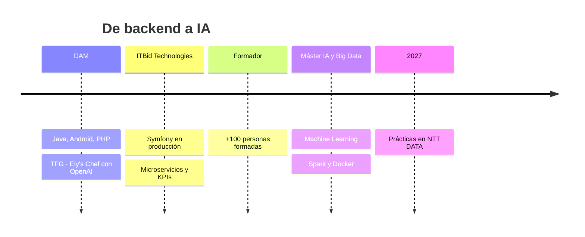

<a href="https://linkedin.com/in/raulanteloramirez">
  <picture>
    <source media="(prefers-color-scheme: dark)" srcset="./assets/banner-dark.svg" />
    <source media="(prefers-color-scheme: light)" srcset="./assets/banner-light.svg" />
    
  </picture>
</a>

<p align="center">
  <a href="https://linkedin.com/in/raulanteloramirez"></a>
  <a href="mailto:raulanteloramirez@gmail.com"></a>
  <a href="https://github.com/SrPineappleDev/ElysChef"></a>
  
  
</p>

<br />

## 🪪 Model card · `raul-antelo`

```yaml
model_id:      raul-antelo
version:       2026.11
architecture:  backend_dev → ml_engineer   # fine-tuning en curso
base_model:    CFGS DAM (Desarrollo de Aplicaciones Multiplataforma)
fine_tuning:   Máster FP Dual en IA y Big Data · IES Fernando Wirtz
partners:      [NTT DATA, Xunta de Galicia]
deployment:    prácticas en NTT DATA · Semana Santa 2027
region:        A Coruña, Galicia
languages:     { es: nativo, en: C1, fr: A2 }
license:       open-to-feedback
```

| | |
|---|---|
| **🎯 Uso previsto** | Convertir datos sucios y problemas reales en modelos que funcionan en producción. |
| **📚 Datos de entrenamiento** | Microservicios Symfony/PHP en producción (ITBid Technologies), KPIs y bugs críticos resueltos en vivo. |
| **⚡ Capacidad emergente** | 3 años formando a +100 personas: explico lo técnico de forma sencilla. |
| **⚠️ Limitaciones conocidas** | Todavía aprendiendo. Por eso tu consejo mejora el modelo: abre un issue o escríbeme. |

<br />

## 📈 Training log



<br />

## 🧩 Features

<table>
<tr>
<td width="50%" valign="top">

**Datos & IA**

<br />


</td>
<td width="50%" valign="top">

**Desarrollo & despliegue**

<br />


</td>
</tr>
</table>

<br />

## 🚀 Inferencia en producción

<table>
<tr>
<td>

### 🍳 Ely's Chef

> **input:** lo que tienes en la nevera &nbsp;→&nbsp; **output:** recetas sencillas con sus calorías

Mi TFG del DAM. Un modelo de lenguaje (API de OpenAI) propone recetas a partir de tus ingredientes y calcula las calorías de cada plato.

`React` `TypeScript` `Vite` `Tailwind` `OpenAI`

> [!NOTE]
> Ahora mismo la base de datos de la demo está **en pausa**, así que es posible que la app no funcione si la pruebas. El código está disponible en el repositorio.

**[→ Ver el repositorio](https://github.com/SrPineappleDev/ElysChef)** &nbsp;·&nbsp; [Demo (BD en pausa)](https://elys-chef.vercel.app)

</td>
</tr>
</table>

<br />

<p align="center">
  <code>model.eval()</code> · ¿Trabajas con datos o IA? <a href="https://linkedin.com/in/raulanteloramirez"><b>Hablemos</b></a> 👋
</p>
